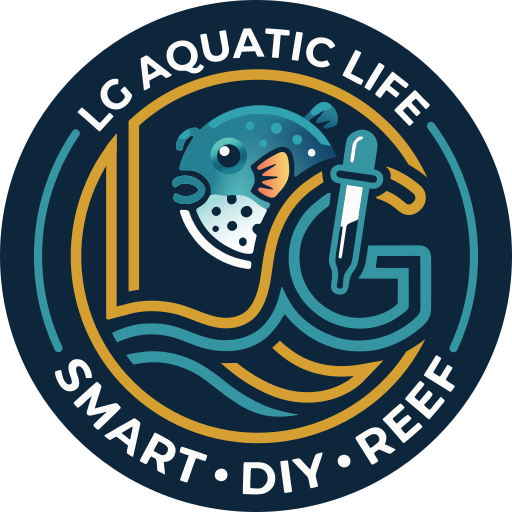

# LG Aquatic Life – Marke

*[English](README.md) · Deutsch*

<p align="center"></p>

Logo und Markendateien von **LG Aquatic Life**, gemeinsam für alle LG-Aquatic-Life-Geräte
(LGAL Doser und spätere). Dieses Repository ist die einzige Quelle: Die Produkt-Repositories
binden es als Git-Submodul ein (auf einen Stand festgelegt, übernommen mit
`git submodule update --remote`) und verlinken darauf; sie enthalten keine Kopien des Logos.

Das Logo ist **nicht** Open Source. Siehe [TRADEMARKS.de.md](TRADEMARKS.de.md). Das gemeinsame
Web-Design in `web/` ist freie Software unter der GPL (siehe [unten](#gemeinsames-web-design)).

## Dateien

| Datei | Verwendung |
|---|---|
| `logo/lgal-plaque.svg` | **Das Logo.** Runde Navy-Plakette mit transparenten Ecken; passt auf hellen und dunklen Hintergrund. |
| `logo/lgal-badge.svg` | Dasselbe auf einem Navy-Quadrat mit abgerundeten Ecken: Avatare, Bilder für soziale Netze. |
| `export/*.png` | PNG-Fassungen: Plakette 256/512/1024 px, Badge 1024 px. |
| `export/lgal-doser-social.png` | Vorschaubild des LGAL-Doser-Repositorys (1280 × 640 px, in den GitHub-Einstellungen hochladen). |
| `source/original.jpg` | Das Original. |
| `source/original.png` | Dasselbe, verlustfrei dekodiert: Eingabe der Werkzeuge. |
| `tools/`, `make.sh` | Bauen die SVG-Dateien aus dem Original neu. |
| `web/` | Das gemeinsame Web-Design der Geräteseiten, siehe [unten](#gemeinsames-web-design). |

## Regeln

- Das Logo steht immer auf seinem Navy-Hintergrund: Plakette oder Badge verwenden. Eine
  invertierte Fassung für helle Hintergründe gibt es nicht; Fisch, Gold und Türkis sind für
  Navy gemacht.
- Farben, Proportionen und den Text der Plakette nicht verändern. Nur als großes Hintergrundbild
  (Wasserzeichen) darf sie abgedimmt, mit verringerter Deckkraft, erscheinen.
- Kleinste Größe: 96 px, darunter ist der Ringtext nicht lesbar. Eine kleinere Fassung gibt es
  nicht; Favicons und App-Icons der Geräte haben ein eigenes Symbol.
- Rund um die Plakette etwas Platz lassen, mindestens ein Zehntel ihres Durchmessers.

Farben:

| Name | Hex |
|---|---|
| Navy | `#0d263b` |
| Türkis | `#3595a2` |
| Gold | `#d69f31` |
| Weiß | `#fbfbf9` |

## Gemeinsames Web-Design

Jedes Gerät liefert seine Seiten aus der eigenen Firmware, aber alle sehen gleich aus. Die Teile
dieses Aussehens liegen hier in `web/`, die Firmware bettet sie beim Bauen ein:

| Datei | Ausgeliefert als | Inhalt |
|---|---|---|
| `web/lgal.css` | `/ui/lgal.css` | Farb-Tokens (dunkles Design, helles daneben), Grundstile, Kopfleiste, Karten, Buttons, Formulare, Schalter, Dialoge, das abgedimmte Logo im Hintergrund und die Stile des Riffs. |
| `web/reef.js` | `/ui/lib/reef.js` | Das Hintergrund-Riff: Korallen, Gorgonien, Seegras und Hirnkorallen in drei Tiefen, im Browser aus einem festen Startwert gezeichnet (jedes Mal dasselbe Bild); Seegras wiegt sich, Blasen steigen auf, aus bei „Bewegung reduzieren“. `drawReef(element)` |
| `web/flags.js` | `/flags.js` | Runde Flaggen der Sprachen (`window.lgalFlags`) und die Stile der Sprachauswahl (`window.lgalLangCss`). |

Ein Gerät ergänzt nach `lgal.css` seine eigenen Stile (der Doser z. B. die Pumpenfarben) und
ändert die gemeinsamen nie; eine Änderung hier gilt für jedes Gerät mit seiner nächsten Firmware.

`web/` steht unter der **GNU General Public License v3.0 oder später** ([web/LICENSE](web/LICENSE)),
wie die Firmware der Geräte. Die Markenregeln für das Logo bleiben unverändert.

## Wie das Logo entstanden ist

Das Original ist ein Rasterbild. Die Werkzeuge in `tools/` bauen die SVG-Dateien daraus neu:

1. `quantize.py` und `trace.py` reduzieren das Bild auf die vier Farben und zeichnen die
   flächigen Teile (Schrift, türkise Linien) mit vtracer nach; `clean.py` setzt sie auf die
   Palette.
2. `circles.py` ersetzt die beiden äußeren türkisen Bögen durch exakte Kreisbögen.
3. `fish.py` baut den Kugelfisch nach: Formen je Farbbereich nachgezeichnet, Schattierung als
   Verläufe an die Pixel des Originals angepasst.
4. `goldmask.py` und `strokes.py` zeichnen jede Goldlinie als einen Strich gleicher Breite auf
   einer glatten Mittellinie: Der Ring ist ein exakter Kreis, die Senkrechten des L sind
   Geraden, die übrigen Linien angepasste Bézierkurven; die Linienenden folgen dem Original.
5. `build.py` setzt die Teile zusammen, `export.py` erzeugt die PNG-Dateien.

Neu bauen (Python 3.12, für neuere Versionen gibt es vtracer noch nicht fertig gebaut):

```bash
python3.12 -m venv .venv
.venv/bin/pip install -r tools/requirements.txt
PYTHON=.venv/bin/python ./make.sh
```

`build/debug/diff.png` vergleicht die Goldlinien mit dem Original (grau = beide, rot = nur
Original, grün = nur neu).

## Vorschaubild eines Produkt-Repositorys

```bash
.venv/bin/python tools/social.py logo/lgal-plaque.svg "LGAL Doser" "Professional smart|open-source dosing pump|for reef aquariums" export/lgal-doser-social.png
```

`make.sh` macht das als letzten Schritt. 1280 × 640 px; `|` beginnt eine neue Zeile. Die Schrift ist Montserrat, falls installiert,
sonst Avenir Next, Helvetica Neue oder Arial.

## Verwendet in

| Repository | Dateien |
|---|---|
| LGAL Doser | Submodul `brand/`: `lgal-plaque.svg` in die Firmware eingebaut (Anmelde- und Einrichtungsseite, abgedimmt im Hintergrund der Web-UI) und `web/` als Design aller seiner Seiten; das README verlinkt auf das Logo; `export/lgal-doser-social.png` als Vorschaubild |

Copyright © 2026 Lars Greiss / LG Aquatic Life. Alle Rechte vorbehalten, außer `web/` (GPL-3.0-or-later).
