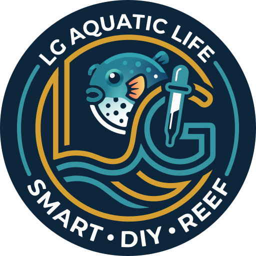

# LG Aquatic Life – brand

*English · [Deutsch](README.de.md)*

<p align="center"></p>

Logo and brand files of **LG Aquatic Life**, shared by all LG Aquatic Life devices (LGAL-Doser
and later ones). This repository is the single source: the product repositories contain copies
of the finished files they need, not this repository.

The logo is **not** open source. See [TRADEMARKS.md](TRADEMARKS.md).

## Files

| File | Use |
|---|---|
| `logo/lgal-plaque.svg` | **The logo.** Round navy plaque with transparent corners; works on light and dark backgrounds. |
| `logo/lgal-badge.svg` | The same on a navy square with rounded corners: avatars, social images. |
| `export/*.png` | PNG renderings: plaque 256/512/1024 px, badge 1024 px. |
| `source/original.jpg` | The original artwork. |
| `source/original.png` | The same, decoded losslessly: input of the tools. |
| `tools/`, `make.sh` | Rebuild the SVG files from the original. |

## Rules

- The logo always sits on its navy background: use the plaque or the badge. There is no
  inverted version for light backgrounds; the fish, the gold and the teal are made for navy.
- Do not change colours, proportions or the text of the plaque. Only as a large background
  picture (watermark) it may be shown dimmed, with reduced opacity.
- Smallest size: 96 px, below that the ring text cannot be read. There is no smaller version;
  favicons and app icons of the devices use their own symbol.
- Keep some free space around the plaque, at least a tenth of its diameter.

Colours:

| Name | Hex |
|---|---|
| Navy | `#0d263b` |
| Teal | `#3595a2` |
| Gold | `#d69f31` |
| White | `#fbfbf9` |

## How the logo was made

The original is a raster image. The SVG files are rebuilt from it by the tools in `tools/`:

1. `quantize.py` and `trace.py` reduce the image to the four colours and trace the flat parts
   (text, teal lines) with vtracer; `clean.py` snaps them to the palette.
2. `circles.py` replaces the two outer teal arcs with exact circular arcs.
3. `fish.py` rebuilds the puffer fish: shapes traced per colour region, shading fitted to the
   original pixels as gradients.
4. `goldmask.py` and `strokes.py` redraw every gold line as one stroke of constant width on a
   smooth centre line: the ring is an exact circle, the verticals of the L are straight lines,
   the other lines are fitted Bezier curves; the line ends follow the original.
5. `build.py` puts the parts together, `export.py` renders the PNG files.

To rebuild (Python 3.12, vtracer has no wheels for newer versions yet):

```bash
python3.12 -m venv .venv
.venv/bin/pip install -r tools/requirements.txt
PYTHON=.venv/bin/python ./make.sh
```

`build/debug/diff.png` compares the gold lines with the original (grey = both, red = original
only, green = new only).

## Social preview of a product repository

```bash
.venv/bin/python tools/social.py logo/lgal-plaque.svg "LGAL-Doser" "Open dosing pump|for reef aquariums" social-preview.png
```

1280 × 640 px; `|` starts a new line. The text uses Montserrat if installed, otherwise Avenir
Next, Helvetica Neue or Arial.

## Used in

| Repository | Files |
|---|---|
| LGAL-Doser | `lgal-plaque.svg` on the sign-in and setup pages of the web UI, dimmed in the background of the web UI and in the README, social preview |

Copyright © 2026 Lars Greiss / LG Aquatic Life. All rights reserved.
